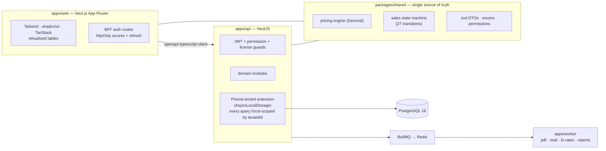

# Cora — architecture notes

> Quote → order → warehouse → shipment in one screen, without the weight of a full ERP.

This document is the narrative companion to the code: why the invariants exist and what each one prevents. The enforced rules themselves are in [`docs/INVARIANTS.md`](docs/INVARIANTS.md); the full (Turkish) architecture constitution is [`docs/CORA_MIMARI.md`](docs/CORA_MIMARI.md); decisions made along the way are logged in [`docs/DECISIONS.md`](docs/DECISIONS.md).

## The shape of the system

## Non-negotiable invariants, and why

1. **Every business table carries `tenantId`** — a Prisma client extension backed by `AsyncLocalStorage` ([`apps/api/src/prisma/prisma-tenant.extension.ts`](apps/api/src/prisma/prisma-tenant.extension.ts)) injects the filter into **every** query, so forgetting it is impossible rather than discouraged. After the extension was in place, a dedicated hardening pass hunted leakage paths through child tables that carry no tenant column of their own — closed and covered by [`apps/api/test/security.spec.ts`](apps/api/test/security.spec.ts).
2. **Money is `Decimal(18,4)` end-to-end**; using `number` for money is banned. All pricing/discount/VAT/margin math lives in exactly one module ([`packages/shared/src/pricing/`](packages/shared/src/pricing/)) — the UI previews and the API persists with the **same tested functions**, so a quote never totals differently on screen than in the database.
3. **Stock changes only through `StockMovement` ledger entries** — no direct writes to `StockLevel`. On-hand quantity is always derivable and auditable. Document numbers come from `DocumentSequence` guarded by `SELECT … FOR UPDATE` (race-safe under concurrent posting), and every document carries a `version` for optimistic locking (concurrent edits → HTTP 409, the UI offers a reload).
4. **All 27 sales-document transitions live in one state machine** ([`packages/shared/src/workflow/sales-state-machine.ts`](packages/shared/src/workflow/sales-state-machine.ts)) together with their required permissions and side effects (reserve / release / deduct stock). Services cannot write `status` directly; a new transition is a table entry plus a test, not an `if` somewhere.
5. **API-first:** everything the UI does is available under `/api/v1/...` with OpenAPI docs — integrations never need screen-scraping or private endpoints.

## Engineering decisions worth stealing

- **RBAC that reaches the serializer.** Cost and profit fields are stripped from API responses at the interceptor layer when the caller lacks `cost.view` — hiding them in the UI is not considered protection. 33 permission codes drive an editable role–permission matrix.
- **Auditability as a default.** Every writing service records a field-level before/after diff to `AuditLog`; soft delete is universal.
- **Licensing built in.** `License { modules[], userLimit, validUntil }` resolves to feature flags; disabled modules disappear from both the menu and the API surface.
- **Coexistence over big-bang migration.** The first customer kept their legacy ERP for accounting; Cora ships Excel bridges and a migration wizard instead of pretending the old system doesn't exist.
- **Evidence-driven delivery.** Each package (P01–P10) shipped with its own tests and screenshots before being declared done; decisions that aren't obvious from the architecture are numbered and logged.

## Testing discipline

- **Unit** (Vitest): the pricing engine, the state machine and stock logic in `packages/shared` — 57 tests.
- **Integration** (Vitest against a real PostgreSQL): 125 API tests, including tenant-isolation security specs that create two tenants and prove cross-tenant reads fail.
- **End-to-end** (Playwright): 55 scenarios covering quote → order → pick → ship → return, run against the production deployment before V1 sign-off — 55/55.
