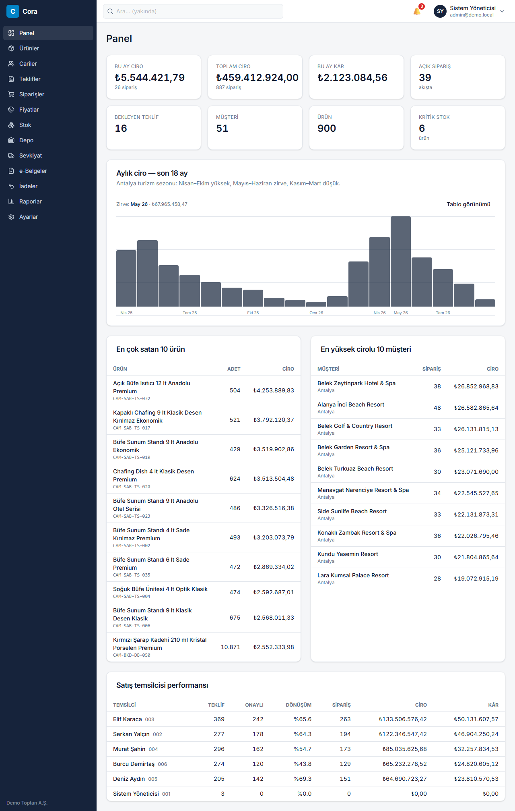
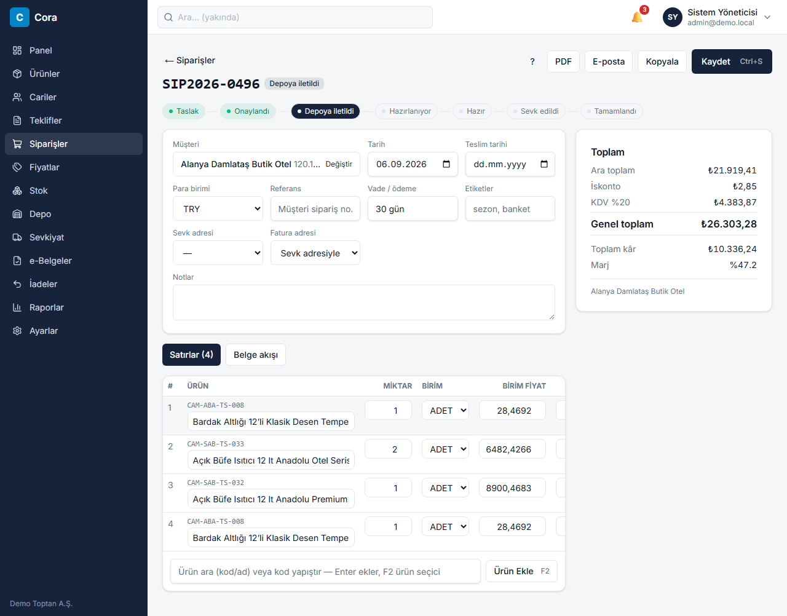
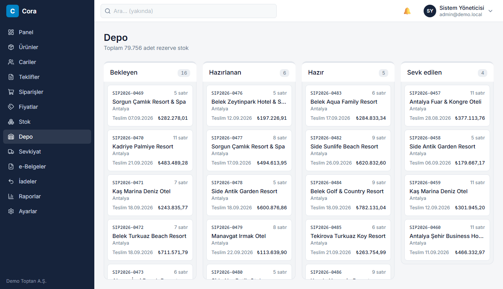
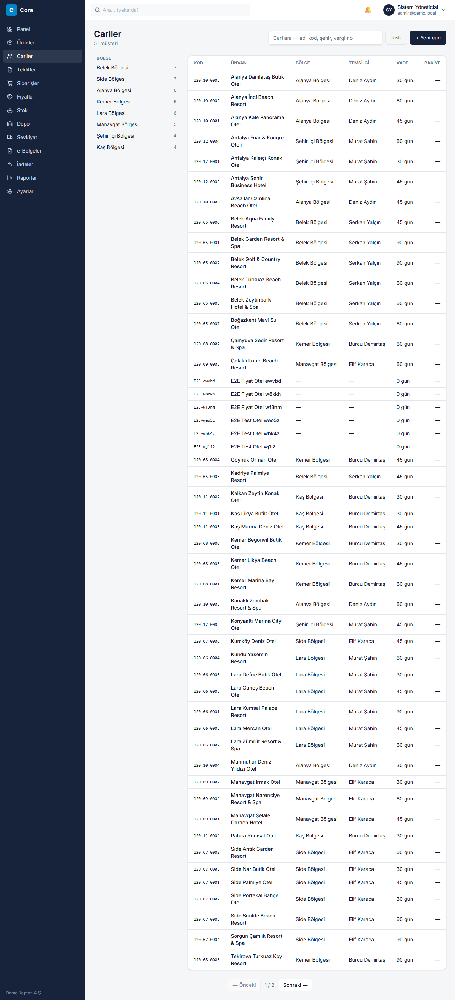
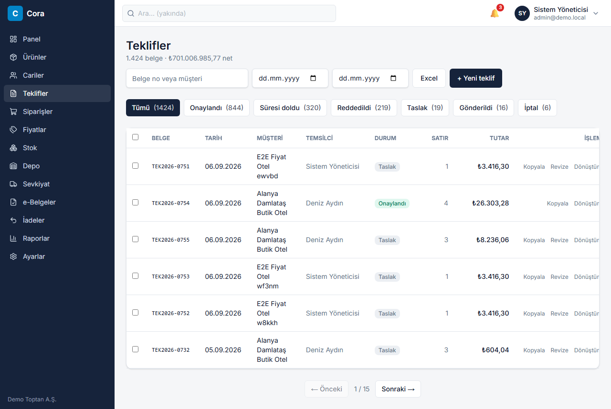
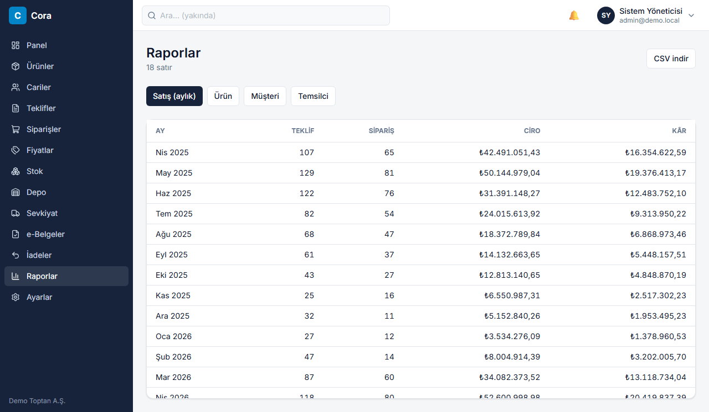
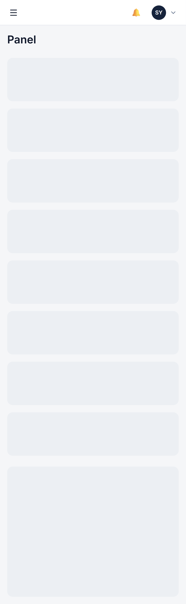

# Cora

> Multi-tenant ERP-lite for wholesale distributors — quote → order → warehouse → shipment in one screen.

Cora is a licensable commercial management system for wholesale businesses that need the sales-to-shipment chain of a full ERP without its weight. V1 ships a complete product catalog, a keyboard-first quote/order editor, a ledger-based inventory core, shipping and returns, PDF/Excel output, receivables and credit-risk tracking, user/role administration, and an e-document pipeline — validated in production with a **55/55 Playwright end-to-end suite** on top of **125 API integration tests and 57 shared unit tests**.

    

> UI language is Turkish (the product targets the Turkish wholesale market). Code, schema and docs structure are in English; UI strings live in a `tr.json` dictionary, so the app is i18n-ready.

---

## Why it exists

The first customer ran daily sales on a legacy desktop ERP: finding a product took a modal-and-field-picker dance, order status was tracked by coloring rows by hand, and nobody could answer "where is my order?" without a phone call. Cora focuses on those four pains — instant product search, fast quote/order entry, a visible document flow, and profit tracking — while deliberately **coexisting** with the legacy system for accounting (Excel import/export bridges, migration wizard for products/partners/opening stock).

## Highlights

- **Tenant isolation enforced in the data layer.** A Prisma client extension backed by `AsyncLocalStorage` injects a mandatory `tenantId` filter into every query; services cannot run without a tenant context. A dedicated hardening pass audited and closed leakage paths through child tables that carry no tenant column of their own (covered by security tests).
- **One pricing engine, one state machine.** Decimal-based pricing/discount/VAT/margin math and a 27-transition sales-document state machine live in `packages/shared`. The web UI previews and the API persists using the **same tested functions**; services cannot write `status` directly, and money math with `number` is banned (`Decimal(18,4)` amounts, line-level rounding for e-invoice compatibility).
- **Ledger-only stock.** Stock levels change exclusively through `StockMovement` entries — no direct writes to `StockLevel`. Document numbers come from `DocumentSequence` guarded by `SELECT … FOR UPDATE` (race-safe), and every document carries a `version` for optimistic locking (concurrent edits → HTTP 409).
- **RBAC that reaches the serializer.** Cost and profit fields are stripped from API responses at the interceptor layer when the caller lacks `cost.view` — hiding them in the UI is not considered enough. Every writing service records a field-level before/after diff to `AuditLog`, and soft delete is universal.
- **Evidence-driven delivery.** An architecture "constitution" ([`docs/CORA_MIMARI.md`](docs/CORA_MIMARI.md), Turkish), a short list of enforced invariants ([`docs/INVARIANTS.md`](docs/INVARIANTS.md)) and a numbered decision log ([`docs/DECISIONS.md`](docs/DECISIONS.md), Turkish) document every milestone; each package shipped with its own test suite and screenshots before being declared done.

## Screenshots

All demo data is fictional (seeded).

| Dashboard | Order editor | Warehouse |
| --- | --- | --- |
|  |  |  |

| Partners | Quotes | Reports | Mobile |
| --- | --- | --- | --- |
|  |  |  |  |

## Features (V1)

| Area | What you get |
| --- | --- |
| Product catalog | Brands, categories, units (base + package/carton), trigram search (`pg_trgm` + `unaccent`), faceted filters, product photos |
| Quotes & orders | Keyboard-first line editor, multi-currency with exchange-rate snapshots, discounts/VAT, document flow (quote → order → shipment), partial shipment per line (`ordered / reserved / shipped`) |
| Inventory | Goods receipts, stock counts, transfers, picking, partial shipments, returns; `onHand / reserved / available` (ATP-style), configurable negative-stock policy |
| Output & import | PDF generation (pure-JS renderer — no Chromium dependency), Excel export with photos embedded in cells, Excel import wizard |
| Partners & finance | Business partner cards (customer/supplier/both) with regions/groups, price lists with quantity tiers, account statements with running balance, credit-limit risk screen, bulk price updates with preview |
| Administration | User management, editable role–permission matrix (33 permission codes), company/document settings, document number prefixes, central-bank exchange-rate fetch, audit-log browser with diffs |
| e-Documents | Provider interface (`sendInvoice` / `sendDespatch` / `queryStatus`) + queue for e-invoice and e-despatch; ships with a null provider, ready for an integrator |
| Hardening | In-app notifications (critical stock, expiring quotes, stuck orders, credit breaches), GDPR/KVKK retention and anonymization tooling, security headers, read/write rate limiting, responsive mobile layout |
| Licensing | `License { modules[], userLimit, validUntil }` → feature flags; disabled modules disappear from both menu and API |

## Architecture

```
apps/web (Next.js 16, App Router)        apps/api (NestJS 12)
  Tailwind 4 · shadcn/ui · TanStack        zod env + DTO validation · OpenAPI (/api/docs)
  BFF auth (httpOnly access+refresh) ───►  JWT + permission + license guards
  openapi-typescript client                │
        │                                  ├─ Prisma 7 (pg driver adapter) ──► PostgreSQL 16
        │                                  │    └─ tenant client extension (AsyncLocalStorage)
        ▼                                  │       every query force-scoped by tenantId
  packages/shared  ◄───────────────────────┤
    pricing engine (Decimal)               └─ BullMQ ──► Redis ──► apps/worker
    sales state machine (27 transitions)         (pdf · mail · fx-rates · reports)
    zod DTOs · enums · utils
```

```
apps/api         NestJS + Prisma, auth/RBAC, tenant context, modules per domain
apps/web         Next.js App Router, BFF auth routes, app shell, virtualized tables
apps/worker      BullMQ workers (pdf, mail, fx-rates, reports)
apps/smoke       minimal boot probe for constrained Node hosting
packages/shared  single source of truth for money math, workflow, and types
docs/            architecture constitution (TR), invariants, decision log, screenshots
```

The deeper narrative — why each invariant exists and what it prevents — is in [`ARCHITECTURE.md`](ARCHITECTURE.md).

## Getting started

Requirements: Node ≥ 20.11, pnpm 10, and either Docker or local PostgreSQL 16 + Redis.

```bash
pnpm install                          # 1) dependencies (+ prisma generate)
docker compose -f docker-compose.dev.yml up -d   # or: brew services start postgresql@16 redis
cp .env.example apps/api/.env         # 2) fill in DATABASE_URL / JWT secrets
pnpm --filter @cora/api db:migrate    # 3) schema (40 models)
pnpm --filter @cora/api db:seed       # 4) demo tenant + fictional demo data
pnpm dev                              # 5) api :3001 + web :3000 + worker
```

Open <http://localhost:3000> (the seed prints the admin password once to the console). API docs at <http://localhost:3001/api/docs>.

## Commands

| Command | Description |
| --- | --- |
| `pnpm dev` | All apps via Turborepo |
| `pnpm lint` / `pnpm typecheck` / `pnpm test` | Quality gates |
| `pnpm e2e` | Playwright end-to-end suite (stack must be running) |
| `pnpm --filter @cora/api db:migrate` / `db:seed` / `db:studio` | Prisma workflows |
| `pnpm --filter @cora/web openapi:types` | Generate TS types from the live OpenAPI spec |

## Testing

- **Unit** (Vitest): pricing engine, state machine, stock logic — 57 tests in `packages/shared`.
- **Integration** (Vitest against a real Postgres): 125 API tests including tenant-isolation security specs. Set `TEST_DATABASE_URL` to a migrated PostgreSQL database; without it these suites skip with a warning.
- **End-to-end** (Playwright): 55 scenarios covering the full quote → order → pick → ship → return flow; point `E2E_BASE_URL` at a running deployment.

## Deployment

Two supported targets, same codebase:

1. **VPS:** GitHub Actions (lint/typecheck/test/build) → container images → `docker compose pull && up -d` → `prisma migrate deploy`, behind a reverse proxy with automatic TLS.
2. **Constrained Node hosting:** `output: standalone` Next build, boot-time migrations (`RUN_MIGRATIONS=true`), and the `apps/smoke` probe for hosts that can't run containers.

## Status & known limits

V1 (packages P01–P10) is complete and running in production. Deliberately out of scope for V1: a real e-invoice integrator (the null provider queues documents honestly), automated FX fetching (manual central-bank pull works), accounting/collections postings, and object storage (images live in the database; PDF is pure JS).

## License

[AGPL-3.0](LICENSE). You are free to use, study and modify Cora, but embedding it in a closed-source product requires opening your source. For commercial licensing without AGPL obligations, reach out via [yigittuzcu.com](https://www.yigittuzcu.com).
